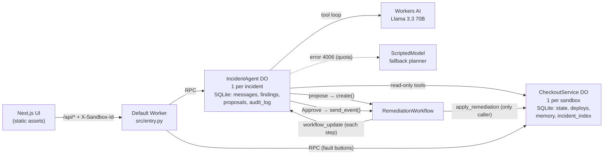

# cf_ai_oncall_copilot

**Live demo:** <https://cf-ai-oncall-copilot.risingspy007-fe3.workers.dev> (Llama 3.3) · **Fallback:** <https://cf-ai-oncall-copilot-scripted.risingspy007-fe3.workers.dev> (scripted planner, no AI quota) · **Demo video:** [docs/demo.mp4](docs/demo.mp4) (57 s: bad deploy → diagnosis → approve rollback → verified and resolved)

An on-call incident copilot that runs entirely on Cloudflare. You tell it
"checkout is throwing 500s". It investigates with read-only tools, checks
whether the team has seen the incident before, and proposes one fix. The fix
runs only after you click **Approve**, as a durable Workflow that snapshots,
applies, verifies and reports.

The app includes a simulated checkout API. It emits metrics, logs and deploy
events, and has three faults you can trigger from the UI. You can run the
whole demo without any real infrastructure.

| Assignment requirement | Cloudflare piece | What it does here |
|---|---|---|
| LLM | **Workers AI**, `@cf/meta/llama-3.3-70b-instruct-fp8-fast` | Reasons over the incident and calls the tools `get_metrics`, `search_logs`, `get_recent_deploys`, `find_similar_incidents` and `propose_remediation` |
| Workflow / coordination | **Durable Objects** + **Workflows** (Python) | One `IncidentAgent` Durable Object per incident runs the chat and tool loop. `RemediationWorkflow` runs the fix as durable steps, with retries and a `wait_for_event` pause for human approval |
| User input | **Next.js** chat UI on Workers static assets | Chat, fault buttons, an approve/reject card, and a live audit log |
| Memory / state | **Durable Object SQLite** | Incident timeline, findings, proposals, audit log, and past resolutions used to find similar incidents |

The backend is written in **Python** (Python Workers, with Python Durable Objects
and a Python Workflow). The UI is a **Next.js** static export served by the same
Worker.

## Architecture

The text in this section and in the
[design doc](docs/designs/oncall_copilot.md) follows ASD-STE100 (Simplified
Technical English).



```text
RemediationWorkflow:  snapshot → report_awaiting → wait_for_event("approval", 1h)
                      → apply (retries 3) → verify (retries 4, exponential) → report
```

* **Why a Durable Object for each incident:** each incident gets one
  consistent, single-threaded location for its state and its chat loop. No
  external database is necessary. A second chat message during a turn gets
  HTTP 409. Poll reads continue to work, because the turn waits for outbound
  I/O.
* **Why the fix is a Workflow:** its steps are durable, and they retry.
  `wait_for_event` gives a pause for the human approval. The pause continues
  after a restart, and it times out after one hour. Each side effect has its
  own named step, because `run()` starts again from the top when the
  instance resumes.
* **Why memory is in `CheckoutService`:** the object of one incident cannot
  read the storage of a different incident. Thus, the service history owns
  "how did we fix this before".
* **Why there are two Workers:** the main Worker uses Llama 3.3. The fallback
  Worker uses the `scripted` environment and has no `AI` binding. Thus, it
  works also when the Workers AI daily quota is empty.

## Guardrails

These guardrails are the core of the project. They follow the design of a
production multi-agent incident agent that I built at Geotab.

1. **Read-only by default.** Each tool that the model can call only reads
   data.
   * `propose_remediation` only records a proposal. It starts a Workflow that
     waits for approval.
   * The model cannot call `apply_remediation`, `set_fault` or `reset`. A
     unit test checks this.
   * `CheckoutService.apply_remediation` refuses unless the incident reports
     the proposal as `approving`. Only an Approve click sets this status.
   * `apply_remediation` is also a **compare-and-set** on the version and the
     fault from the proposal time. If the service changes before the
     approval, the proposal ends `stale`. The service does not change.
2. **No invented numbers.** Before the UI shows an answer, code finds each
   number in the answer. Each number must be in a tool result of this
   incident.
   * Tool arguments, timestamps, ids and old model text are not evidence.
   * If a number fails the check, the model gets one rewrite request.
   * If the rewrite also fails, the code replaces the unverified numbers with
     `[unverified]`. The audit log keeps the raw draft.
   * The UI shows a "numbers verified" badge on each answer.
3. **No fix without a symptom.** The code accepts `propose_remediation` only
   if a tool result shows a symptom. A symptom is a metric at 1.5 times its
   baseline or more, or ERROR or WARN logs. Without a symptom, the model gets
   a tool error, and it says that checkout looks healthy. A live test showed
   that a prompt rule alone does not stop Llama (0/3). With this gate, the
   result is 5/5.
4. **Bad tool calls do not stop the turn.** The validator uses the same flat
   JSON schemas that the model gets.
   * It converts string integers, refuses booleans, applies enums and
     ranges, and removes unknown keys.
   * A bad call returns a clear error to the model.
   * A second bad call to the same tool in one turn stops the tool loop. The
     model then answers from the evidence that it has.
   * The loop also accepts tool calls that Llama writes as JSON text
     (`<|python_tag|>`). It refuses more than 4 calls in one step, and a
     proposal before an investigation.
5. **Model errors and quota.** If Workers AI returns error `4006` (daily
   quota empty), the scripted planner completes the turn. The audit log gets
   `model_fallback`, and the UI shows a banner with the fallback URL. For
   other model errors, the answer is "The model is unavailable right now; no
   actions were taken."
6. **Audit log.** SQLite stores each tool call, validation error, number
   check, proposal, approval, rejection, fallback and Workflow step. The UI
   shows them live.
7. **Public URL safety.** Each browser gets a random sandbox id. Thus,
   visitors do not share faults or memory. The Workers Rate Limiting binding
   permits a maximum of 10 chat turns each minute for each sandbox.

## Run it

Prerequisites: Node 20+, Python 3.13+.

```bash
git clone https://github.com/bandhanp1804/cf_ai_oncall_copilot && cd cf_ai_oncall_copilot
npm install && npm run setup     # web deps + .venv with uv and pywrangler
npm test                         # 39 unit tests, standard-library unittest only
```

To check the real model, start `npm run dev` and run `npm run check:llama`. It
asks "Why is checkout failing?" with no fault and with each of the three
faults, 3 times each, and checks Llama proposes the matching fix (or none when
healthy). Add `-- --base <url>` to run it against the deployed Worker, or
`-- --runs 5 --only none -v` to focus on one case. This makes real Workers AI calls.

For the end-to-end reliability check (design V6), run
`npm run check:live -- --base <url>`. It runs CUJ 1 (diagnose) and CUJ 4
(recall a past fix) 10 times each. Each run approves the first fix, so the
second incident has a memory match. It stops, with no score, on an HTTP error,
a scripted server or an empty Workers AI quota. 10 runs use about 20 chats of
the 10,000-neuron daily free quota.

**Local, no Cloudflare account needed.** This uses the `scripted` env: the same
Durable Objects, Workflow and tool loop, with a fixed planner in place of
Llama 3.3. That's needed because the Workers AI binding always runs remotely.

```bash
npm run dev:scripted             # http://localhost:8787
```

**Local, with Llama 3.3 on Workers AI:**

```bash
npx wrangler login
npm run dev                      # http://localhost:8787
```

**Deploy:**

```bash
npx wrangler login
npm run deploy                   # builds web/out, then pywrangler deploy
```

To deploy on every push with **Workers Builds** (Git integration), set the
Worker's build settings to build command `npm run build` and deploy command
`npm run deploy:ci`. The root `postinstall` installs `web/`'s dependencies, and
`deploy:ci` installs `pywrangler`, which bundles the Python Workers SDK.

**Workers AI quota fallback.** On the free plan, Workers AI allows 10,000
neurons a day. When a model call fails with `4006` (daily allocation used up),
the turn switches to the scripted planner mid-turn. It's recorded as
`model_fallback` in the audit log, and the UI shows a banner linking the
fallback Worker. `npm run deploy:scripted` deploys that fallback, the
`scripted` env, as `cf-ai-oncall-copilot-scripted`. It has no AI binding, so it
always works.

For UI work with hot reload, run `npm run dev:scripted` in one terminal and
`npm run dev:web` in another, then open http://localhost:3000.

## Demo walkthrough

1. Click **Trigger a fault → Bad deploy**. The error-rate tile turns red within
   about 10 s.
2. Ask **"Why is checkout failing?"**. The audit log fills with
   `get_metrics`, `get_recent_deploys`, `search_logs` and
   `find_similar_incidents`. The answer names `v2.15.0`, quotes the error rate
   from the tool output with a ✓ numbers-verified badge, and shows a proposal
   card: *Roll back v2.15.0 → v2.14.1*.
3. Click **Approve**. The card steps through Snapshot → Approval → Apply →
   Verify → Report. Verify retries while the error rate falls, then the
   incident becomes `resolved` and is saved to memory.
4. Trigger **Bad deploy** again and open a new incident. The answer now says
   *"This matches past incident inc-… ; you fixed it before with
   rollback_deploy to v2.14.1."*
5. Try **Reject**, or change the fault after a proposal is made and then
   approve it. The Workflow ends `rejected` or `stale`, and nothing changes.

| Fault | Symptoms | Expected fix |
|---|---|---|
| Bad deploy | Error rate 22–26%, `NullPointerException at PaymentClientV2` | `rollback_deploy` to the previous version |
| DB pool exhaustion | Error rate 8–12%, p95 about 2.8 s, pool 50/50 | `scale_db_pool` |
| Latency spike | p95 about 4.1 s, payments-gateway timeouts | `failover_payment_provider` |

## Verification status

| Check | Result |
|---|---|
| Unit tests (`npm test`) | 39 pass on CPython 3.13 |
| Next.js static export (`npm run build`) | passes |
| End-to-end in `wrangler dev`, scripted env: CUJ 1 diagnose, CUJ 2 approve and verify, CUJ 3 reject, CUJ 4 recall, stale compare-and-set, double-click 409, sandbox isolation | all pass (2026-11-12) |
| Live Llama 3.3: tool-message format, 10-run pass rate for CUJ 1 and CUJ 4 (design V5/V6) | **pending:** needs `wrangler login` |

## How this was built

This project uses Google's
[Elephant-Goldfish Model](https://github.com/google/elephant-goldfish-model):
write the spec with full context (the elephant), review it with fresh-context
subagents that see only the document (goldfish), resolve the findings, then
build to the spec.

* [`concepts_brief.md`](concepts_brief.md): the original plan as a concept brief
* [`docs/designs/oncall_copilot.md`](docs/designs/oncall_copilot.md): the
  design doc, with goals, CUJs, architecture, the state machines and the
  implementation plan
* [`docs/designs/review/goldfish_review_report.md`](docs/designs/review/goldfish_review_report.md):
  24 findings from two goldfish reviewers (design critic and implementation
  readiness, the latter checked against the Python Workers SDK source), and
  how each was resolved
* [`PROMPTS.md`](PROMPTS.md): the AI prompt history

## Trade-offs and what I'd change for production

* **Python instead of the TypeScript Agents SDK.** The Agents SDK is
  TypeScript-only. Here the chat persistence and tool loop are written by hand
  (`copilot.py`, `agent.py`), and the Workflow's `wait_for_event` replaces the
  SDK's in-chat approval, which gives an approval that survives restarts and
  expires.
* **Polling instead of streaming.** The number check needs the whole answer
  before any of it is shown, so streaming tokens would stream unchecked
  numbers. The UI polls the audit log every 1.5 s, and only while something is
  running.
* **Llama 3.3 tool calling** is less reliable than frontier models. Flat
  schemas, the validator, the strict text-call parser and the retry cap are
  the mitigation. The live pass rate goes in the table above.
* **Workers static assets instead of Cloudflare Pages.** The UI is one static
  page, the Next.js export in `web/out`. The Worker serves it as static assets,
  on the same origin as `/api/*`. Pages can also serve it, but it adds two
  costs:
  * A second deploy. The UI and the API can then be on different versions.
  * Cross-origin requests. Each API call then needs CORS headers for the
    `pages.dev` origin.

  The same-origin Worker needs neither. Cloudflare also recommends Workers
  static assets for new projects. See Alternative D in the
  [design doc](docs/designs/oncall_copilot.md).
* **For production:** real telemetry adapters behind the same tool interfaces,
  auth on the approval endpoint (with the approver recorded), Vectorize
  embeddings for similar-incident search once memory outgrows a table scan,
  and per-metric number matching.

## Layout

```text
src/entry.py        Worker routes (/api/*), sandbox and rate-limit checks
src/agent.py        IncidentAgent Durable Object: chat turn, proposals, workflow updates
src/service.py      CheckoutService Durable Object: simulator state, deploys, memory
src/remediation.py  RemediationWorkflow (Python Workflow)
src/copilot.py      Tool loop, tool-call parsing, number check orchestration (pure Python)
src/guardrails.py   Argument validation, number extraction/check/redaction
src/tools.py        Tool schemas (shared by the model and the validator)
src/sim.py          Simulated checkout API (pure function of state and time)
src/memory.py       Fingerprints and similar-incident scoring
src/ops.py          Remediation validation, compare-and-set apply
src/scripted.py     Fixed planner for local runs and tests
src/prompts.py      System and rewrite prompts sent to Llama 3.3
web/                Next.js UI (static export)
tests/              unittest suite
scripts/llama_check.py  Live check of the real model's proposals (npm run check:llama)
```
